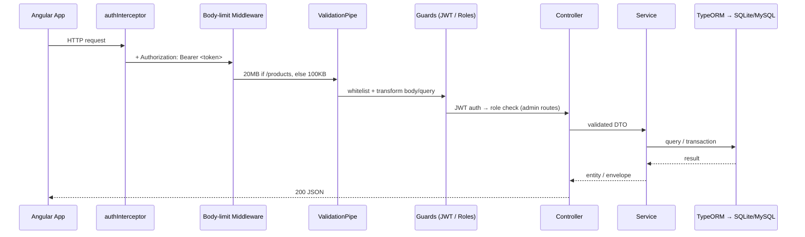

# Architecture

## System Overview

```mermaid
flowchart LR
    subgraph Client
        B[Browser]
    end

    subgraph Vercel["Vercel (SPA)"]
        FE[Angular 21 Frontend<br/>dist/frontend/browser]
    end

    subgraph Render["Render"]
        BE[NestJS 11 Backend]
    end

    subgraph DB[(Database)]
        SQLite[(SQLite<br/>dev: database.sqlite)]
        MySQL[(MySQL<br/>prod)]
    end

    B --> FE
    B -->|API calls with Bearer JWT| BE
    FE -.apiUrl.-> BE
    BE --> SQLite
    BE --> MySQL
```

- **Frontend**: Angular 21 standalone SPA on Vercel. Dev: `http://localhost:4200` → API at `http://localhost:3000`. Prod: Vercel → `https://swaggedup-backend.onrender.com`.
- **Backend**: NestJS 11 on Render, port 3000 (dev), TypeORM with SQLite (dev) or MySQL (prod).

## Request Flow



On any error, the global `HttpExceptionFilter` returns:

```json
{ "success": false, "message": "…", "statusCode": 400 }
```

## Module Map

| Module        | Responsibility                                                        |
| ------------- | --------------------------------------------------------------------- |
| `AppModule`   | Root: imports Database, Users, Auth, Categories, Products, Orders      |
| `DatabaseModule` | TypeORM config (dual-mode), migrations run at startup, hosts SeederService |
| `AuthModule`  | Login endpoint, JWT signing, strategy/guard/roles                     |
| `UsersModule` | User entity + service (no controller) — used by Auth & Orders         |
| `CategoriesModule` | Category CRUD (public read, ADMIN write, soft delete)            |
| `ProductsModule` | Product CRUD, variants, search/filter, base64 image validator     |
| `OrdersModule` | Guest checkout, public tracking, admin orders controller + dashboard stats |

## Conventions

- **Response envelope**: list endpoints return `{ <resource>: [...], total, page, limit }`; single-object responses return the raw entity.
- **Error envelope**: `{ success: false, message, statusCode }` — validation arrays joined into one string, no stack traces.
- **Validation**: global `ValidationPipe` with `whitelist: true, transform: true` — unknown properties stripped, DTOs via class-validator.
- **CORS**: single origin from `CORS_ORIGIN` (default `http://localhost:4200`), credentials enabled.
- **Body limits**: 20MB for `/products` paths (base64 images), 100KB elsewhere.
- **Soft deletes**: `categories` and `products` use `DeleteDateColumn`.
- **Slugs**: auto-generated from names; product slugs get a random 4-digit suffix; duplicates rejected with 409.
