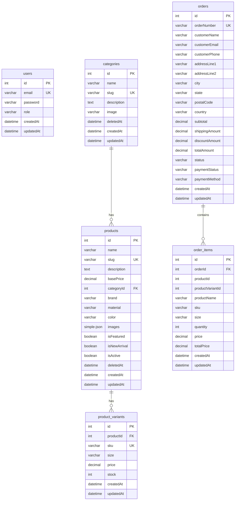

# Data Models

## Entity Relationship Diagram

## Table Details

### `users`

| Column       | Type      | Constraints                          |
| ------------ | --------- | ------------------------------------ |
| id           | int       | PK, auto-increment                   |
| email        | varchar   | Unique                               |
| password     | varchar   | bcrypt hash, `@Exclude()` from JSON   |
| role         | varchar   | Default `'ADMIN'`; values: ADMIN, CUSTOMER |
| createdAt / updatedAt | datetime | Auto                              |

No registration endpoint — users are created by the seeder (admin) or auto-created at checkout (CUSTOMER with random password).

### `categories`

Soft delete (`deletedAt`). `slug` unique, auto-generated from `name`. OneToMany → products (cascade).

### `products`

- `basePrice` decimal(10,2); `images` stored as `simple-json` (array of base64 data URLs, max 5).
- Flags: `isFeatured`, `isNewArrival`, `isActive`.
- `slug` unique, auto-generated with random 4-digit suffix.
- Soft delete; FK `categoryId` → categories (CASCADE).
- OneToMany → `product_variants` (cascade).

### `product_variants`

- `sku` unique; `size` string (S/M/L/XL, shoe 7–10, "One Size"); `price` decimal; `stock` int default 0.
- FK `productId` → products (CASCADE).

### `orders`

- `orderNumber` unique, format `SW-YYYYMMDD-####`.
- `status`: PENDING → PROCESSING → SHIPPED → DELIVERED (+ CANCELLED).
- `paymentStatus`: PENDING, PAID, FAILED, REFUNDED. `paymentMethod` default `'COD'`.
- Money columns decimal(10,2): subtotal, shippingAmount, discountAmount, totalAmount.

### `order_items` — Snapshot Pattern

Line items **snapshot** product data at purchase time (`productName`, `sku`, `size`, `price`, `totalPrice`) plus `productId`/`productVariantId` references. Historical orders remain accurate even if products are later modified or deleted.

## Migration & Seeding

- Schema managed only via migrations (`synchronize: false`, `migrationsRun: true`). Current: `1787303731806-InitialSchema.ts`.
- Seeder (on bootstrap; prod requires `RUN_SEEDER=true`): admin user (`admin@swaggedup.com` / `admin123` — dev only), 9 categories, 20 demo products with variants and randomized stock (some zero-stock for demo).
