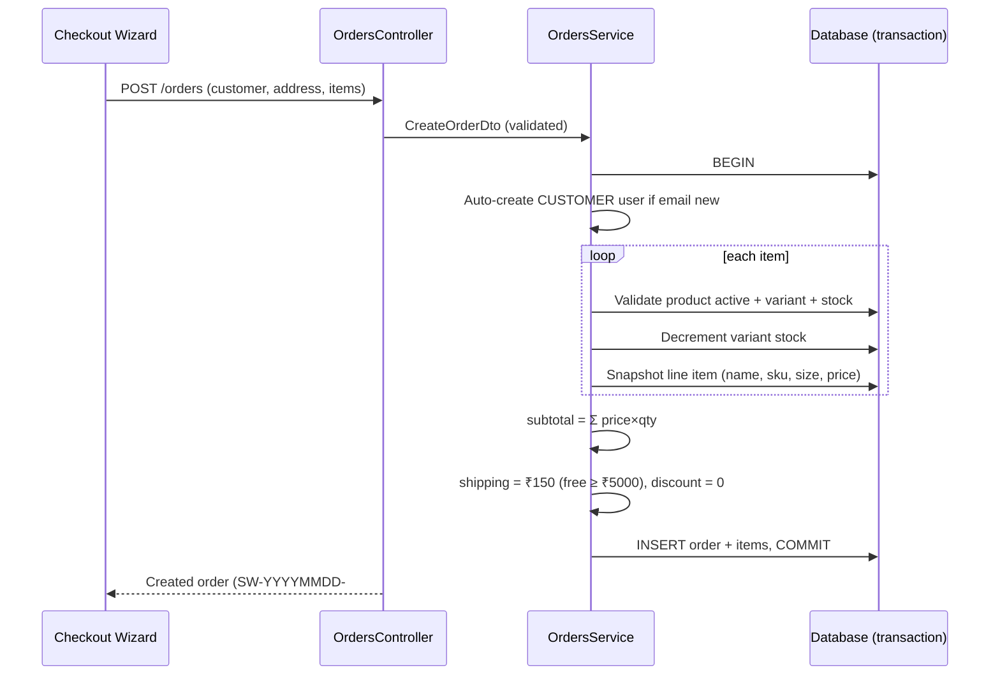
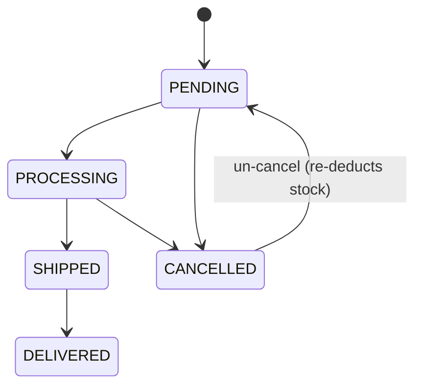
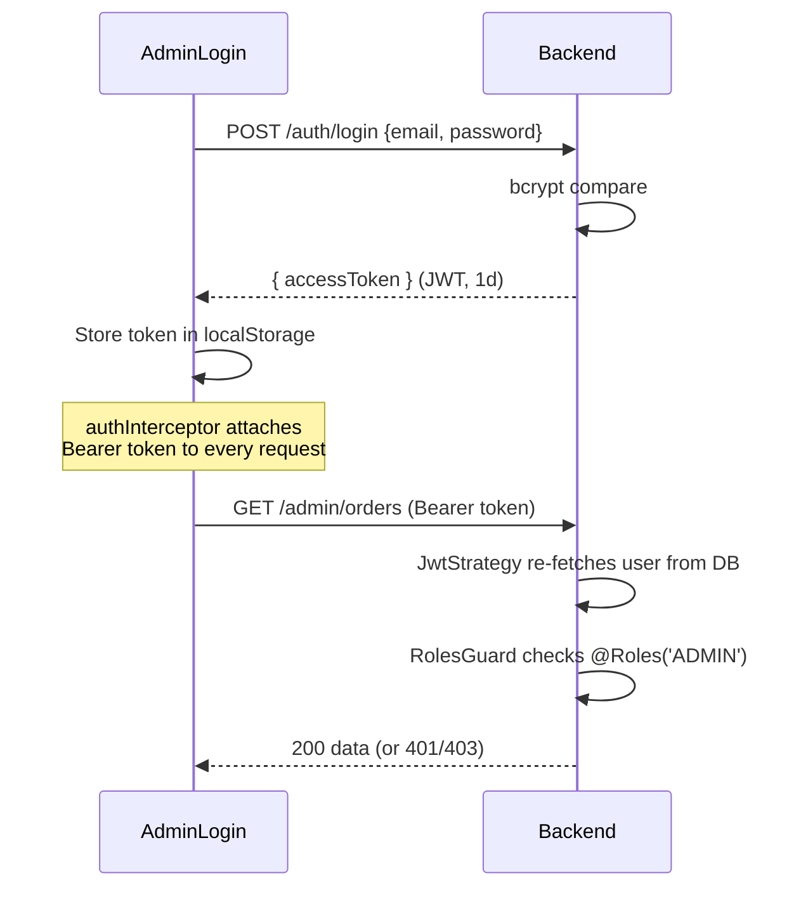
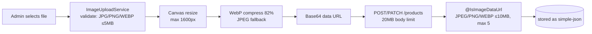
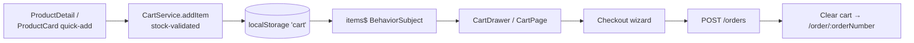

# Key Flows

## Guest Checkout (Transactional)

Any failure (validation, insufficient stock) rolls back the entire transaction — stock is never partially decremented.

## Order Lifecycle

- **Cancel** (`PATCH /admin/orders/:id/status` with `CANCELLED`): restores variant stock.
- **Un-cancel**: re-deducts stock; fails with 400 if insufficient.
- Payment status updated independently via `PATCH /admin/orders/:id/payment-status`.

## Admin Auth Flow

## Image Upload Pipeline

No multipart/file storage — images are embedded as base64 data URLs in the product row.

## Cart State Flow (Frontend)

